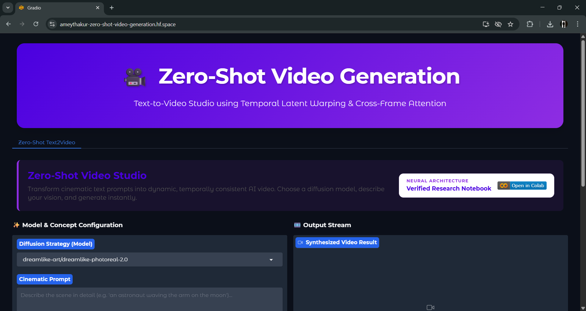
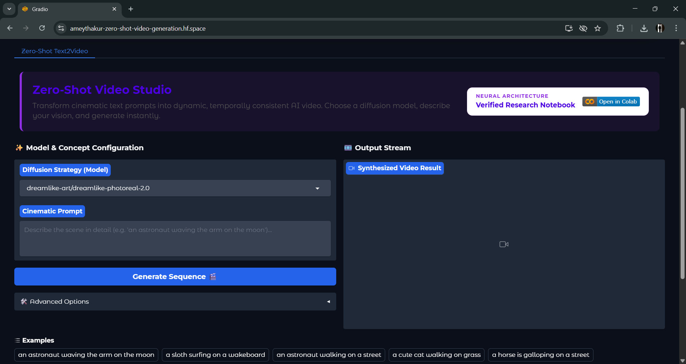
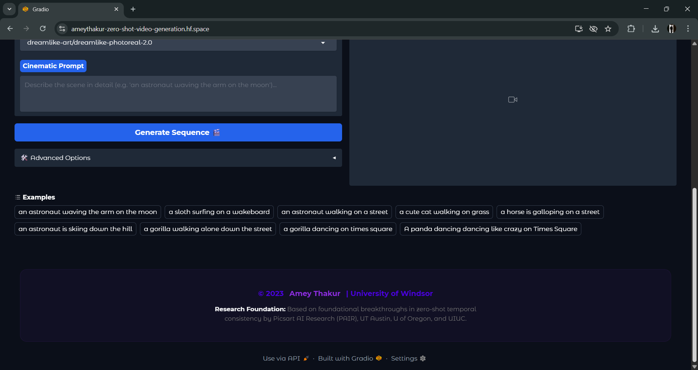
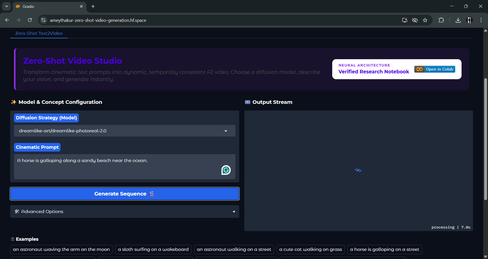
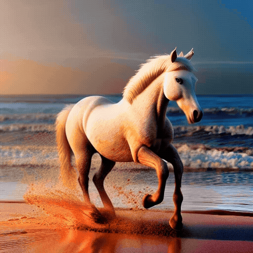

<div align="center">

  # Zero-Shot Video Generation

  [](LICENSE)
  
  [](https://github.com/Amey-Thakur/ZERO-SHOT-VIDEO-GENERATION)
  [](https://github.com/Amey-Thakur/ZERO-SHOT-VIDEO-GENERATION)

  A zero-shot neural synthesis studio leveraging latent diffusion models and cross-frame attention to synthesize temporally consistent video sequences directly from unconstrained textual prompts.

  **[Source Code](Source%20Code/)** &nbsp;·&nbsp; **[Project Report](https://github.com/Amey-Thakur/MACHINE--LEARNING/blob/main/ML%20Project/Zero-Shot%20Video%20Generation%20Project%20Report.pdf)** &nbsp;·&nbsp; **[Video Demo](https://youtu.be/za9hId6UPoY)** &nbsp;·&nbsp; **[Live Demo](https://huggingface.co/spaces/ameythakur/Zero-Shot-Video-Generation)**

  <br>

  <a href="https://youtu.be/za9hId6UPoY">
    
  </a>

</div>

---

<div align="center">

  [Authors](#authors) &nbsp;·&nbsp; [Overview](#overview) &nbsp;·&nbsp; [Features](#features) &nbsp;·&nbsp; [Structure](#project-structure) &nbsp;·&nbsp; [Results](#results) &nbsp;·&nbsp; [Quick Start](#quick-start) &nbsp;·&nbsp; [Usage Guidelines](#usage-guidelines) &nbsp;·&nbsp; [License](#license) &nbsp;·&nbsp; [About](#about-this-repository) &nbsp;·&nbsp; [Acknowledgments](#acknowledgments)

</div>

---

<!-- AUTHORS -->
<div align="center">

  <a name="authors"></a>
  ## Authors

| <a href="https://github.com/Amey-Thakur"></a><br>[**Amey Thakur**](https://github.com/Amey-Thakur)<br><br>[](https://orcid.org/0000-0001-5644-1575) |
| :---: |

</div>

> [!IMPORTANT]
> ### 🤝🏻 Special Acknowledgement
> *Special thanks to **Jithin Gijo** and **Ritika Agarwal** for their meaningful contributions, guidance, and support that helped shape this work.*

---

<!-- OVERVIEW -->
<a name="overview"></a>
## Overview

**Zero-Shot Video Generation** is an advanced neural synthesis framework designed to transform textual descriptions into temporally consistent video sequences. By leveraging a training-free paradigm of cross-domain latent transfer (repurposing pre-trained **Latent Diffusion Models (LDMs)**), this project enables dynamic motion synthesis without requiring specialized video-based training datasets.

The core architecture implements a specialized inference-time logic that constrains the generative process across a discrete temporal axis. This addresses the fundamental challenge of **spatial-temporal manifold consistency**, ensuring that a sequence of independent latent samples converges into a coherent motion trajectory that mirrors the nuanced semantics of the input prompt.

> [!IMPORTANT]
> ### Attribution
> This project builds upon the foundational research and implementation of the **[Text2Video-Zero](https://arxiv.org/abs/2303.13439)** repository by **[Picsart AI Research (PAIR)](https://github.com/picsart-ai-research)**.

> [!NOTE]
> ### 🎥 Defining Zero-Shot Video Synthesis
> In the context of generative AI, **Zero-Shot Video Synthesis** refers to the production of video content where the model has not been explicitly trained on motion data. The system operates by injecting **temporal structural priors**, specifically **cross-frame attention** and **latent trajectory warping**, into a pre-trained image generator. This method eliminates the prohibitive computational and data costs of traditional video models while preserving the generative stylistic capabilities of large-scale diffusion backbones.

The repository serves as a comprehensive technical case study into **Generative Machine Learning**, **Latent Space Dynamics**, and **Neural Attention Modulation**. It bridges the gap between theoretical research and practical deployment through an optimized **Gradio-based interactive studio**, allowing for high-performance experimentation with zero-shot motion synthesis heuristics.

### Synthesis Heuristics
The generative engine is governed by strict **computational design patterns** ensuring fidelity and temporal coherence:
*   **Temporal Consistency**: Custom cross-frame attention layers and latent warping ensure background stability and smooth object motion across sequential frames.
*   **Zero-Shot Inference**: Harnessing foundational image diffusion models (e.g., Stable Diffusion) to synthesize motion dynamically without specialized video fine-tuning.
*   **Architectural Flexibility**: Supports multiple diffusion backbones, allowing adaptive synthesis paths tailored to diverse visual aesthetics and rendering requirements.

> [!TIP]
> **Spatial-Temporal Precision Integration**
>
> To maximize sequence clarity, the engine employs a **multi-stage neural pipeline**. **Latent motion fields** refine the temporal stream, strictly coupling structural dynamics with state changes. This ensures the generated scene constantly aligns with the underlying textual simulation.

---

<!-- FEATURES -->
<a name="features"></a>
## Features

| Feature | Description |
|---------|-------------|
| **Core Diffusion** | Integrates **Stable Diffusion pipelines** customized for continuous temporal frame synthesis. |
| **Interactive Studio** | Implements a robust standalone interface via Gradio for immediate generative video study. |
| **Academic Clarity** | In-depth and detailed scholarly comments integrated throughout the codebase for transparent logic study. |
| **Neural Topology** | Efficient hardware acceleration via **PyTorch** and CUDA ensuring optimal tensor computations. |
| **Inference Pipeline** | Modular architecture supporting multiple model checkpoints directly from the **Hugging Face Hub**. |
| **Motion Warping** | Advanced **latent trajectory mapping** ensuring realistic subject motion and background preservation. |

> [!NOTE]
> ### Interactive Polish: The Visual Singularity
> We have engineered a premium, logic-driven interface that exposes the complex text-to-video synthesis pipeline simply and elegantly. The visual language focuses on a modern gradient aesthetic, ensuring maximum focus on generative analysis.

### Tech Stack
- **Languages**: Python 3.8+
- **Logic**: **Neural Pipelines** (Cross-frame Attention & Latent Warping)
- **Frameworks**: **PyTorch** & **Diffusers**
- **UI System**: Modern Design (Gradio & Custom CSS)
- **Execution**: Local acceleration (CUDA) / CPU gracefully degraded fallback

---

<!-- STRUCTURE -->
<a name="project-structure"></a>
## Project Structure

```python
ZERO-SHOT-VIDEO-GENERATION/
│
├── docs/                            # Academic Documentation
│   └── SPECIFICATION.md             # Technical Architecture
│
├── ML Project/                      # Research Assets & Deliverables
│   ├── Zero-Shot Video Generation - Project Proposal.pdf
│   ├── Zero-Shot Video Generation Project Report.pdf
│   ├── Zero-Shot Video Generation.pdf
│   └── Zero-Shot Video Generation.mp4
│
├── Source Code/                     # Primary Application Layer
│   ├── annotator/                   # Auxiliary Processing Modules
│   ├── app.py                       # Main Gradio Studio Interface
│   ├── app_text_to_video.py         # UI Components for Text2Video
│   ├── config.py                    # Architectural Configurations
│   ├── gradio_utils.py              # UI Helper Utilities
│   ├── hf_utils.py                  # Hub Scraping & Model Loading
│   ├── model.py                     # Neural Orchestration & Inference
│   ├── text_to_video_pipeline.py    # Temporal Denoising & Warping Logic
│   ├── utils.py                     # Processing & Attention Mechanisms
│   ├── environment.yaml             # Conda Environment Config
│   ├── requirements.txt             # Dependency Manifest
│   └── style.css                    # Component Styling
│
├── screenshots/                     # Visual Synthesis Gallery
│   ├── 01_studio_interface.png      # Application UI
│   ├── 02_model_configuration.png   # Parameter Setup
│   ├── 03_neural_processing.png     # Inference Visualization
│   ├── 04_generation_results.png    # Output Verification
│   └── zero_shot_video_output.mp4   # Sample Generated Video
│
├── .gitattributes                   # Signal Normalization
├── .gitignore                       # Deployment Exclusions
├── SECURITY.md                      # Security Protocols
├── CITATION.cff                     # Academic Citation Manifest
├── codemeta.json                    # Metadata Standard
├── LICENSE                          # MIT License
├── README.md                        # Project Entrance
└── ZERO-SHOT-VIDEO-GENERATION.ipynb # Research Notebook
```

---

<a name="results"></a>
## Results

  <div align="center">
  <b>Main Interface: Modern Design</b>
  <br>
  <i>Initial system state with clean aesthetics and synchronized brand identity.</i>
  <br><br>
  
  <br><br><br>

  <b>Synthesis Orchestration: Neural Config</b>
  <br>
  <i>Configuring latent diffusion pipelines and temporal consistency heuristics for motion generation.</i>
  <br><br>
  
  <br><br><br>

  <b>Latent Trajectory: Real-Time Inference</b>
  <br>
  <i>System Distillery visualizing the denoising process across the temporal manifold.</i>
  <br><br>
  
  <br><br><br>

  <b>Generative Result: Temporal Convergence</b>
  <br>
  <i>A horse is galloping along a sandy beach near the ocean.</i>
  <br><br>
  
  <br><br><br>

  <b>Generated Result Output: Neural Motion Sequence</b>
  <br>
  <i>Verified spatial-temporal consistency within the generated latent trajectory.</i>
  <br><br>
  
  <br><br>
  <video src="https://github.com/Amey-Thakur/ZERO-SHOT-VIDEO-GENERATION/raw/main/screenshots/zero_shot_video_output.mp4" width="90%" controls loop autoplay muted></video>
  <br><br>
  <a href="https://github.com/Amey-Thakur/ZERO-SHOT-VIDEO-GENERATION/raw/main/screenshots/zero_shot_video_output.mp4" download><b>Download Original MP4</b></a>
</div>

---

<!-- QUICK START -->
<a name="quick-start"></a>
## Quick Start

### 1. Prerequisites
- **Python 3.8+**: Required for runtime execution. [Download Python](https://www.python.org/downloads/)
- **Git**: For version control and cloning. [Download Git](https://git-scm.com/downloads)
- **CUDA Toolkit**: (Optional but highly recommended) For GPU acceleration.

### 2. Installation & Setup

#### Step 1: Clone the Repository
Open your terminal and clone the repository:
```bash
git clone https://github.com/Amey-Thakur/ZERO-SHOT-VIDEO-GENERATION.git
cd ZERO-SHOT-VIDEO-GENERATION
```

#### Step 2: Configure Virtual Environment
Prepare an isolated environment to manage dependencies:

**Windows (Command Prompt / PowerShell):**
```bash
python -m venv venv
venv\Scripts\activate
```

**macOS / Linux (Terminal):**
```bash
python3 -m venv venv
source venv/bin/activate
```

#### Step 3: Install Core Dependencies
Navigate to the source directory and install the required libraries:
```bash
cd "Source Code"
pip install -r requirements.txt
```

### 3. Execution

#### A. Interactive Web Studio
Launch the primary Gradio-based studio engine from the `Source Code` directory:
```bash
python app.py
```

**Studio Access**: Once the engine is initialized, navigate to the local URL provided in the terminal (typically `http://127.0.0.1:7860`). You can also enable public access by passing the `--public_access` flag during initialization.

> [!TIP]
> ### Temporal Motion Synthesis | Latent Diffusion Studio
>
> Experience the interactive **Zero-Shot Video Generation** environment directly in your browser through the working **Hugging Face Space**. This platform features a **Latent Diffusion Model (LDM)** integrated with a **cross-frame attention** architecture to synthesize continuous motion, providing a visual demonstration of spatial-temporal interpolation and generative sequence boundaries.
>
> **[Launch Zero-Shot Video Studio on Hugging Face](https://huggingface.co/spaces/ameythakur/Zero-Shot-Video-Generation)**

#### B. Research & Automation Studio

Execute the complete **Neural Video Synthesis Research** directly in the cloud. This interactive environment provides a zero-setup gateway for orchestrating temporal synthesis research.

> [!IMPORTANT]
> ### Zero-Shot Video Generation | Cloud Research Laboratory
>
> Execute the complete **Neural Video Synthesis Research** directly in the cloud. This interactive **Google Colab Notebook** provides a zero-setup environment for orchestrating neural text-to-video synthesis, offering a scholarly gateway to the underlying Python-based latent diffusion and cross-frame attention architecture.
>
> **[Launch Zero-Shot Video Studio on Google Colab](https://github.com/Amey-Thakur/ZERO-SHOT-VIDEO-GENERATION/blob/main/ZERO-SHOT-VIDEO-GENERATION.ipynb)**

---

<!-- USAGE GUIDELINES -->
<a name="usage-guidelines"></a>
## Usage Guidelines

This repository is openly shared to support learning and knowledge exchange across the academic community.

**For Students**  
Use this project as reference material for understanding **Neural Video Synthesis**, **Diffusion Models**, and **temporal latent interpolation**. The source code is explicitly annotated to facilitate self-paced learning and exploration of **Python-based generative deep learning pipelines**.

**For Educators**  
This project may serve as a practical lab example or supplementary teaching resource for **Machine Learning**, **Computer Vision**, and **Generative AI** courses. Attribution is appreciated when utilizing content.

**For Researchers**  
The documentation and architectural approach may provide insights into **academic project structuring**, **cross-frame attention mechanisms**, and **zero-shot temporal generation paradigms**.

---

<!-- LICENSE -->
<a name="license"></a>
## License

This repository and all linked academic content are made available under the **MIT License**. See the [LICENSE](LICENSE) file for complete terms.

> [!NOTE]
> **Summary**: You are free to share and adapt this content for any purpose, even commercially, as long as you provide appropriate attribution to the original author.

Copyright © 2023 Amey Thakur

---

<!-- ABOUT -->
<a name="about-this-repository"></a>
## About This Repository
**Created & Maintained by**: [Amey Thakur](https://github.com/Amey-Thakur)  
**Academic Journey**: Master of Engineering in Computer Engineering (2023-2024)  
**Course**: [ELEC 8900 · Machine Learning](https://github.com/Amey-Thakur/MACHINE--LEARNING)  
**Institution**: [University of Windsor](https://www.uwindsor.ca/), Windsor, Ontario  
**Faculty**: [Faculty of Engineering](https://www.uwindsor.ca/engineering/)

This project features **Zero-Shot Video Generation**, an advanced generative visual synthesis system designed to produce temporally consistent motion sequences from textual prompts. It represents a structured academic exploration into the frontiers of deep learning and latent space dynamics developed as part of the 3rd Semester Project at the University of Windsor.

**Connect:** [GitHub](https://github.com/Amey-Thakur) &nbsp;·&nbsp; [LinkedIn](https://www.linkedin.com/in/amey-thakur) &nbsp;·&nbsp; [ORCID](https://orcid.org/0000-0001-5644-1575)

### Acknowledgments

Grateful acknowledgment to my **Major Project** teammates, **Jithin Gijo** and **Ritika Agarwal**, for their collaborative excellence and shared commitment throughout the semester. Our collective efforts in synthesizing complex datasets, developing rigorous technical architectures, and authoring comprehensive engineering reports were fundamental to the successful realization of our objectives. This partnership not only strengthened the analytical depth of our shared deliverables but also provided invaluable insights into the dynamics of high-performance engineering teamwork.

Grateful acknowledgment to **Jason Horn**, **[Writing Support Desk](https://github.com/Amey-Thakur/WRITING-SUPPORT)**, **University of Windsor**, for his distinguished mentorship and scholarly guidance. His analytical feedback and methodological rigor were instrumental in refining the intellectual depth and professional caliber of my academic work. His dedication stands as a testament to the pursuit of academic excellence and professional integrity.

Special thanks to the research team behind **Text2Video-Zero** (Picsart AI Research, UT Austin, U of Oregon, UIUC) for the foundational research and open-source implementation, which served as the cornerstone for this project's technical architecture.

---

<!-- FOOTER SECTION -->
<div align="center">

  [↑ Back to Top](#zero-shot-video-generation)

  [Authors](#authors) &nbsp;·&nbsp; [Overview](#overview) &nbsp;·&nbsp; [Features](#features) &nbsp;·&nbsp; [Structure](#project-structure) &nbsp;·&nbsp; [Results](#results) &nbsp;·&nbsp; [Quick Start](#quick-start) &nbsp;·&nbsp; [Usage Guidelines](#usage-guidelines) &nbsp;·&nbsp; [License](#license) &nbsp;·&nbsp; [About](#about-this-repository) &nbsp;·&nbsp; [Acknowledgments](#acknowledgments)

  <br>

  🧠 **[Machine Learning Repository](https://github.com/Amey-Thakur/MACHINE--LEARNING)** &nbsp;·&nbsp; 🎥 **[Zero-Shot Video Generation](https://huggingface.co/spaces/ameythakur/Zero-Shot-Video-Generation)**

  ---

  #### Presented as part of the 3rd Semester Project @ University of Windsor

  ---

  ### 🎓 [MEng Computer Engineering Repository](https://github.com/Amey-Thakur/MENG-COMPUTER-ENGINEERING)

  **Computer Engineering (M.Eng.) - University of Windsor**

  *Semester-wise curriculum, laboratories, projects, and academic notes.*

</div>

